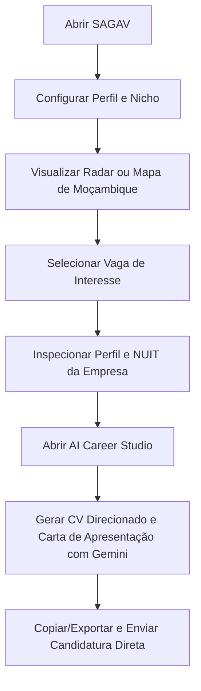
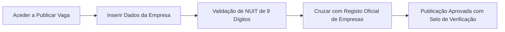

# ⚙️ Como Funciona o SAGAV

> **Status:** Módulo em Desenvolvimento Ativo (Alpha)  
> **Objetivo:** Democratizar o acesso a empregos legítimos em Moçambique e no mercado remoto global através de automação inteligente, geolocalização e IA.

---

## 1. A Filosofia e o Problema que Resolve

Em mercados emergentes como Moçambique, a maioria das oportunidades reais de trabalho sofre de três problemas centrais:
1. **Dispersão Extrema**: Vagas são partilhadas em grupos fechados de WhatsApp, posts informais de LinkedIn e portais dispersos (ex.: CBE, Emprego.co.mz).
2. **Proliferação de Fraudes / Scams**: Falsos recrutadores cobram taxas indevidas de candidatura ou criam ofertas fictícias.
3. **Barreira na Candidatura**: Candidatos enviam CVs genéricos sem alinhamento com os requisitos exigidos pelo anunciante.

O **SAGAV** resolve estes três pontos criando um **ecossistema seguro com verificação anti-fraude**, um **radar visual com mapas locais reais** e um **gerador de candidaturas alinhadas por IA**.

---

## 2. Fluxo de Utilização: Candidato

### Passo a Passo:
1. **Configuração Discreta no Perfil**:
   - O utilizador indica as suas competências, resumo profissional, área de atuação e preferências de localização (Moçambique ou Global Remoto).
   - Pode inserir a sua própria chave da **Google Gemini API** para desbloquear chamadas de nuvem em tempo real (ou usar o gerador inteligente offline integrado).
2. **Radar de Vagas Segmentado**:
   - As vagas apresentadas respeitam o nicho do candidato.
   - O mapa de Moçambique acende pontos de iluminação dinâmicos nas províncias com vagas abertas (Maputo, Matola, Beira, Tete, Pemba, etc.).
3. **Inspecção de Legitimidade**:
   - O candidato clica no nome da empresa e abre o **Perfil Corporativo**, vendo o NUIT, sector, sede, website e vagas em aberto.
4. **Candidatura Otimizada com IA**:
   - Com 1 toque em *"Gerar CV Direcionado"*, a IA reescreve a experiência do candidato evidenciando exactamente os pontos fortes requeridos pela vaga.

---

## 3. Fluxo de Utilização: Empresas e Recrutadores

Para impedir a criação de ofertas fraudulentas, o SAGAV estabelece um **filtro estrito de verificação**:

- **Validação de NUIT**: É obrigatório introduzir um NUIT válido (9 dígitos numéricos moçambicanos).
- **Email Corporativo**: O sistema valida domínios oficiais (ex.: `@mcel.mz`, `@vodacom.mz`, `@standardbank.co.mz`).
- **Acesso ao Perfil de Candidatos**: As empresas verificadas podem examinar o perfil completo, portfólio e histórico de candidatos qualificados.

---

## 4. Como Funciona o Parser do WhatsApp / Redes Sociais

Muitos utilizadores recebem dezenas de mensagens de vagas diariamente em grupos de WhatsApp, mas acham cansativo transcrevê-las manualmente.

O SAGAV disponibiliza o **Importador Inteligente de Texto Bruto**:
1. O utilizador simplesmente copia e cola o texto completo da mensagem recebida no WhatsApp na aba *Publicar Vaga*.
2. O algoritmo do SAGAV processa a mensagem automaticamente, extraindo:
   - **Cargo**: Detecta padrões como *"Vaga:", "Procura-se:", "Posição:"*.
   - **Localização / Província**: Identifica cidades de Moçambique (*Maputo, Matola, Beira, Nampula, Tete, etc.*).
   - **Remuneração**: Extrai valores em Meticais (MZN) ou USD.
   - **Contacto / Email**: Extrai expressões de email e números móveis moçambicanos (+258 84/82/87/85).
3. Os campos do formulário são pré-preenchidos em segundos, restando apenas confirmar a publicação.

---

## 5. Como Funciona o Motor de IA (Google Gemini 1.5 Flash)

O serviço de IA (`src/services/geminiService.js`) opera em duas modalidades integradas:

1. **Modo Conectado (API Key)**:
   - Liga-se directamente aos servidores da Google através do endpoint do modelo `gemini-1.5-flash`.
   - Gera documentos profissionais formatados com base num prompt rigoroso de engenharia de carreira.
2. **Modo Heurístico Inteligente (Offline Fallback)**:
   - Se a chave de API não for fornecida ou o utilizador estiver sem internet no telemóvel, um motor local sintetiza o CV e a Carta de Apresentação com base em templates estratégicos de RH, garantindo que a aplicação nunca fica bloqueada.
